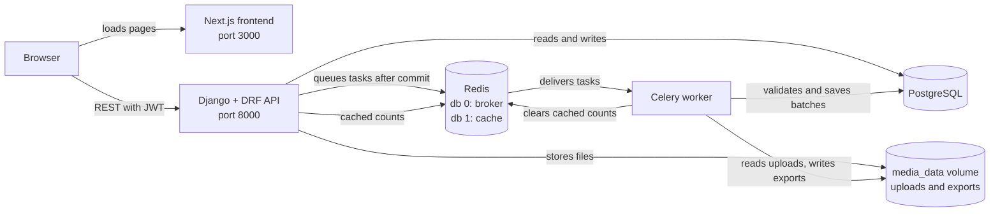
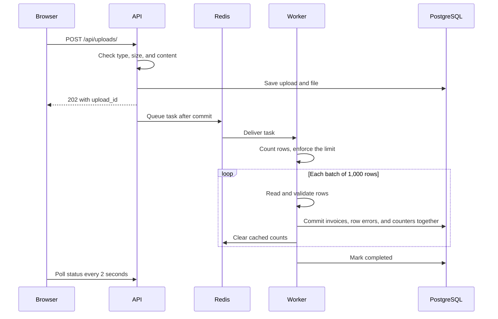

# InvoiceFlow

InvoiceFlow is a bulk invoice processing module for merchants. A merchant uploads a CSV or XLSX file of 10,000–100,000 invoices, a background worker validates and stores each row, and the merchant can track progress, download an error report, and search, filter, sort, and export their invoices.

**Stack:** Django 5.2, Django REST Framework, SimpleJWT, Celery, Redis, PostgreSQL 17, Next.js 16 (App Router), React, TypeScript, Tailwind, Docker Compose.

## Contents

- [Features](#features)
- [Setup and run](#setup-and-run)
- [Architecture](#architecture)
- [API contract](#api-contract)
- [Data model](#data-model)
- [Upload processing](#upload-processing)
- [Export lifecycle](#export-lifecycle)
- [Caching](#caching)
- [Seed data](#seed-data)
- [Design decisions and rejected alternatives](#design-decisions-and-rejected-alternatives)
- [Scaling plan](#scaling-plan)
- [Assumptions and ambiguities](#assumptions-and-ambiguities)
- [Known limitations](#known-limitations)
- [What was cut and why](#what-was-cut-and-why)
- [Testing](#testing)
- [AI usage](#ai-usage)

## Features

- JWT registration and login, with automatic token refresh in the frontend
- CSV and XLSX upload that returns immediately and processes in the background
- Row validation, with valid rows stored as invoices and invalid rows recorded with reasons
- Retries for transient failures that never create duplicate invoices
- Live progress by polling, with success and failure counts
- Downloadable CSV error report
- Invoice list with search, status, date, and amount filters, sorting, and pagination
- Asynchronous CSV export of the current search and filters
- Redis cache for filtered invoice totals
- Merchant isolation on every endpoint
- Seed command for test files and test data

## Setup and run

### Prerequisites

- [Docker Desktop](https://www.docker.com/products/docker-desktop/), or Docker Engine with Compose
- Git

Everything runs in containers, so Python and Node.js are not needed on the host.

### Start the application

```bash
git clone https://github.com/ambady-dileep/InvoiceFlow.git
cd InvoiceFlow
cp .env.example .env
docker compose up -d --build
```

On Windows Command Prompt, use `copy .env.example .env`.

The placeholder values in `.env` work for local use. To change the database password, change it in both `POSTGRES_PASSWORD` and `DATABASE_URL` before the first start.

The backend applies migrations when it starts. Open <http://localhost:3000> and create a merchant account.

| Service | Compose name | Host address |
|---|---|---|
| Frontend | `frontend` | <http://localhost:3000> |
| Backend API | `backend` | <http://localhost:8000> |
| PostgreSQL | `db` | `localhost:5433` |
| Redis | `redis` | `localhost:6380` |
| Celery worker | `worker` | Not published |

All ports are published on `127.0.0.1` only. PostgreSQL and Redis use `5433` and `6380` to avoid clashing with local installations.

Use `localhost`, not `127.0.0.1`, in the browser, because the API only allows the `http://localhost:3000` origin. A `next dev` server running on the host can also take over `localhost:3000`, so stop it when testing the container.

### Useful commands

```bash
docker compose ps                  # Service status
docker compose logs -f worker      # Follow the worker logs
docker compose restart worker      # Load backend code changes into the worker
docker compose down                # Stop everything and keep the data
docker compose down -v             # Stop everything and delete all data
```

The backend reloads code automatically, but the worker does not.

## Architecture



The browser calls the API directly, so the frontend server only serves pages. The API and worker share one image definition, so they always have the same code, environment, and media volume.

| Path | Purpose |
|---|---|
| `backend/apps/accounts` | Registration and authentication routes |
| `backend/apps/imports` | Uploads, file parsing, the processing task, and error reports |
| `backend/apps/invoices` | Invoices, row validation, listing, exports, caching, and the seed command |
| `backend/config` | Settings, URLs, and the Celery app |
| `frontend/app` | Pages: login, invoices, and uploads |
| `frontend/components` | Reusable interface components |
| `frontend/lib` | API client, token refresh, and token storage |

## API contract

The base URL is `http://localhost:8000`.

Every endpoint needs an `Authorization: Bearer <access token>` header, except `GET /api/health/`, `POST /api/auth/register/`, `POST /api/auth/login/`, and `POST /api/auth/token/refresh/`. Access tokens last 5 minutes, and refresh tokens last 1 day.

| Method | Path | Purpose |
|---|---|---|
| `GET` | `/api/health/` | Health check |
| `POST` | `/api/auth/register/` | Create a merchant |
| `POST` | `/api/auth/login/` | Get tokens |
| `POST` | `/api/auth/token/refresh/` | Get a new access token |
| `POST` | `/api/uploads/` | Upload a file |
| `GET` | `/api/uploads/` | List uploads |
| `GET` | `/api/uploads/{id}/status/` | Get upload progress |
| `GET` | `/api/uploads/{id}/errors/` | Download the error report |
| `GET` | `/api/invoices/` | List invoices |
| `POST` | `/api/invoices/export/` | Start an export |
| `GET` | `/api/exports/{id}/` | Get export status |
| `GET` | `/api/exports/{id}/download/` | Download an export |

### Errors

| Status | Meaning | Body |
|---|---|---|
| `400` | Invalid input | `{"field": ["message"]}` |
| `401` | Missing, invalid, or expired token | `{"detail": "message"}` |
| `404` | Not found, or owned by another merchant | `{"detail": "message"}` |
| `405` | Method not allowed | `{"detail": "message"}` |
| `415` | Upload is not `multipart/form-data` | `{"detail": "message"}` |
| `503` | The upload could not be stored | `{"detail": "message"}` |

Another merchant's resource returns the same `404` as one that does not exist, so IDs cannot be probed.

### Health

`GET /api/health/` returns `200`:

```json
{"status": "ok"}
```

### Register

`POST /api/auth/register/`

```json
{"username": "merchant", "email": "merchant@example.com", "password": "Str0ng-Passphrase!"}
```

Returns `201`:

```json
{"id": 36, "username": "merchant", "email": "merchant@example.com"}
```

Usernames and emails must be unique, ignoring case. Passwords must pass Django's password validators. Returns `400` otherwise:

```json
{
  "username": ["A user with that username already exists."],
  "email": ["A user with that email already exists."]
}
```

### Login

`POST /api/auth/login/`

```json
{"username": "merchant", "password": "Str0ng-Passphrase!"}
```

Returns `200` with `access` and `refresh` tokens:

```json
{"refresh": "<refresh token>", "access": "<access token>"}
```

Wrong credentials return `401`:

```json
{"detail": "No active account found with the given credentials"}
```

### Refresh a token

`POST /api/auth/token/refresh/`

```json
{"refresh": "<refresh token>"}
```

Returns `200` with a new access token, or `401` if the refresh token is invalid:

```json
{"access": "<access token>"}
```

### Upload a file

`POST /api/uploads/`, as `multipart/form-data` with a `file` field.

```bash
curl -X POST http://localhost:8000/api/uploads/ \
  -H "Authorization: Bearer <access token>" \
  -F "file=@invoices.csv;type=text/csv"
```

Returns `202`:

```json
{
  "upload_id": 73,
  "status": "pending",
  "original_filename": "invoices.csv",
  "created_at": "2026-11-01T21:43:07.116192Z"
}
```

Files must be CSV or XLSX, up to 25 MB. The required columns are `invoice_number`, `customer_name`, `amount`, `invoice_date`, and `status`, and other columns are ignored. Invalid files return `400`:

```json
{"file": ["Missing required columns: customer_name, invoice_date, status."]}
```

### List uploads

`GET /api/uploads/?page=1&page_size=25` returns the merchant's uploads, newest first. `page_size` defaults to 25, up to 100. Returns `200`:

```json
{
  "count": 1,
  "next": null,
  "previous": null,
  "results": [
    {
      "upload_id": 73,
      "status": "completed",
      "progress": 100,
      "total_rows": 2,
      "processed_rows": 2,
      "successful_rows": 1,
      "failed_rows": 1,
      "failure_reason": "",
      "created_at": "2026-11-01T21:43:07.116192Z",
      "original_filename": "invoices.csv"
    }
  ]
}
```

### Get upload progress

`GET /api/uploads/{id}/status/` returns `200`, with the same fields as a list result except `original_filename`:

```json
{
  "upload_id": 73,
  "status": "processing",
  "progress": 46,
  "total_rows": 100000,
  "processed_rows": 46000,
  "successful_rows": 45990,
  "failed_rows": 10,
  "failure_reason": "",
  "created_at": "2026-11-01T21:43:07.116192Z"
}
```

| Field | Meaning |
|---|---|
| `status` | `pending`, `processing`, `completed`, or `failed` |
| `progress` | Whole percentage. Only a `completed` upload shows 100 |
| `total_rows` | Non-blank data rows in the file |
| `processed_rows` | Rows handled so far, always `successful_rows + failed_rows` |
| `failure_reason` | Why the file failed, otherwise empty |

`completed` means the whole file was processed, even if some or all rows were invalid. `failed` means the file itself could not be processed.

### Download an error report

`GET /api/uploads/{id}/errors/` returns `200` with a streamed `text/csv` attachment, one line per message:

```csv
row_number,column,message
3,amount,Enter a valid number.
3,invoice_date,Enter a valid date in YYYY-MM-DD format.
3,invoice_number,This field is required.
3,status,"Enter one of: pending, paid, overdue."
```

An upload with no row errors returns only the header. During processing, the report holds the batches committed so far.

### List invoices

`GET /api/invoices/`

| Parameter | Purpose |
|---|---|
| `search` | Case-insensitive text within `invoice_number` or `customer_name`. Every term must match |
| `status` | `pending`, `paid`, or `overdue` |
| `invoice_date__gte`, `invoice_date__lte` | Date range, including both ends |
| `amount__gte`, `amount__lte` | Amount range, including both ends |
| `ordering` | `invoice_number`, `customer_name`, `amount`, `invoice_date`, or `status`. Prefix with `-` to reverse, and separate several fields with commas. Defaults to `-invoice_date` |
| `page`, `page_size` | `page_size` defaults to 25, up to 100 |

```bash
curl "http://localhost:8000/api/invoices/?search=acme&status=paid&amount__gte=100&ordering=-amount" \
  -H "Authorization: Bearer <access token>"
```

Returns `200`:

```json
{
  "count": 1,
  "next": null,
  "previous": null,
  "results": [
    {
      "id": 1040103,
      "invoice_number": "INV-1001",
      "customer_name": "Acme Traders",
      "amount": "1250.50",
      "invoice_date": "2026-01-15",
      "status": "paid"
    }
  ]
}
```

Invalid filter values return `400`, and a page that does not exist returns `404`:

```json
{"status": ["Select a valid choice. cancelled is not one of the available choices."]}
```

### Start an export

`POST /api/invoices/export/` takes the same `search`, filter, and `ordering` query parameters as the invoice list. Pagination parameters are ignored. There is no request body.

```bash
curl -X POST "http://localhost:8000/api/invoices/export/?status=paid&ordering=-amount" \
  -H "Authorization: Bearer <access token>"
```

Returns `202`, or `400` for invalid filters:

```json
{
  "export_id": 13,
  "status": "pending",
  "row_count": 0,
  "failure_reason": "",
  "download_url": null,
  "created_at": "2026-11-01T21:43:09.919245Z"
}
```

### Get export status

`GET /api/exports/{id}/` returns `200`:

```json
{
  "export_id": 13,
  "status": "completed",
  "row_count": 1,
  "failure_reason": "",
  "download_url": "/api/exports/13/download/",
  "created_at": "2026-11-01T21:43:09.919245Z"
}
```

`download_url` stays `null` until the export is `completed`.

### Download an export

`GET /api/exports/{id}/download/` returns `200` with a `text/csv` attachment, or `404` until the export is `completed`. It needs the token, because files are never served publicly.

```csv
invoice_number,customer_name,amount,invoice_date,status
INV-1001,Acme Traders,1250.50,2026-01-15,paid
```

The columns match the upload format, and the internal `id` is not included.

## Data model

| Model | Purpose | Key fields |
|---|---|---|
| `User` | Django's built-in user, used as the merchant | `username`, `email`, `password` |
| `Upload` | One uploaded file | `merchant`, `file`, `original_filename`, `status`, `total_rows`, `processed_rows`, `successful_rows`, `failed_rows`, `failure_reason` |
| `Invoice` | One valid row | `merchant`, `upload`, `row_number`, `invoice_number`, `customer_name`, `amount`, `invoice_date`, `status` |
| `UploadRowError` | One invalid row | `upload`, `row_number`, `errors` (column names mapped to lists of messages) |
| `InvoiceExport` | One export | `merchant`, `query`, `status`, `file`, `row_count`, `failure_reason` |

Deleting a merchant or upload cascades to the records under it.

### Constraints

| Rule | Purpose |
|---|---|
| Unique `Invoice (merchant, invoice_number)` | One invoice number per merchant, across all uploads |
| Unique `Invoice (upload, row_number)` | A source row can only be stored once |
| Unique `UploadRowError (upload, row_number)` | A source row can only be reported once |
| Foreign key `Invoice (upload, merchant)` to `Upload (id, merchant)` | An invoice cannot belong to a different merchant than its upload |
| Checks on `Invoice.amount` and `Invoice.status` | `bulk_create` skips model validation, so the database enforces these |

Django cannot declare a composite foreign key, so a hand-written migration adds it. This makes the project depend on PostgreSQL.

### Indexes

| Index | Query it serves |
|---|---|
| `Upload (merchant, -created_at)` | Upload history |
| `Invoice (merchant, -invoice_date)` | Default invoice list and date filter |
| `Invoice (merchant, status, -invoice_date)` | Status filter |
| `Invoice (merchant, amount)` | Amount filter and sorting |

`Invoice` and `Upload` turn off the default foreign key indexes where these indexes and constraints already cover them, because each extra index slows bulk inserts.

## Upload processing



### Validation

**During the request:**

- The extension must be `.csv` or `.xlsx`, and the content type must match it.
- The file must not be empty, or larger than 25 MB.
- CSV files are checked from a 64 KB sample for UTF-8 encoding, the required columns, and at least one data row.
- XLSX files are checked for a valid ZIP archive containing a workbook.

Stored paths use generated names, so client filenames never reach the filesystem.

**In the worker:**

- XLSX files are rejected if they decompress to more than 100 MB, before parsing.
- Both formats are checked for required columns and at most 100,000 rows.
- Each row is validated independently, and every error in the row is reported.

| Column | Rule |
|---|---|
| `invoice_number` | Required, at most 50 characters, unique per merchant |
| `customer_name` | Required, at most 255 characters |
| `amount` | Required, a finite decimal of zero or more, at most 2 decimal places and 14 digits |
| `invoice_date` | Required, `YYYY-MM-DD` or a real Excel date |
| `status` | Required, `pending`, `paid`, or `overdue`, in any case |

Text is trimmed, and blank rows are skipped. Error messages never repeat uploaded values, so the report cannot carry a spreadsheet formula, and any cell that could start one gets a leading `'`.

### Batching and memory

Files are read as streams, so rows are never all in memory. The worker reads the file twice: first to count rows, which sets the progress total and rejects oversized files before anything is stored, and then to save rows in batches of 1,000.

Rows are validated outside the transaction, so no database lock is held while parsing.

### Retries and idempotency

Each batch's invoices, row errors, and counters commit in one transaction, so a crash loses a whole batch or none of it. A retry or redelivery skips `processed_rows` rows and continues from there.

- Each batch locks its `Upload` and checks `processed_rows`, so a duplicate delivery stops instead of inserting twice.
- Each batch also locks the merchant, so concurrent uploads cannot both pass the duplicate check. Without this lock, the unique constraint would reject the whole batch.
- The locks use `FOR NO KEY UPDATE`, so they do not block new uploads.

### Failure handling

| Failure | Behaviour |
|---|---|
| Invalid file content | `failed` with a reason, no retry |
| File missing from storage | `failed`, no retry |
| Database connection or file I/O error | Retried 3 times, after 30, 60, and 120 seconds, then `failed` |
| Unexpected error | Logged, then `failed` with a generic reason |
| Task runs past 600 seconds | Soft time limit marks it `failed` |
| Worker killed | Redis redelivers the task after the 15-minute visibility timeout, and it resumes |
| Redis down during upload | The upload is stored, then marked `failed` with a reason |

Tasks are published after the transaction commits, so a worker cannot start before the upload exists. Publishing runs in a short-lived thread, so a Redis outage does not delay the request.

## Export lifecycle

1. `POST /api/invoices/export/` validates the filters, saves an `InvoiceExport` as `pending`, and queues a task after commit.
2. The worker applies the invoice list's own filter, search, and ordering code, so the export matches what the merchant sees.
3. Rows are read with a database iterator into a temporary file, so the result set is never all in memory.
4. The finished file is attached and the export becomes `completed`, so a partial file can never be downloaded.
5. The frontend polls `GET /api/exports/{id}/` every 2 seconds, then shows a download button.
6. The download endpoint checks the token and ownership, then streams the file.

Transient errors retry with the same schedule as uploads and rewrite the file from the start. Other failures mark the export `failed` with a reason. The Export button is disabled while an export runs, and changing the search, filters, or sorting clears the previous result.

## Caching

Redis caches one thing: the invoice list's total `count` for each combination of filters. It is the slow query that repeats without changing, because every page turn and sort recounts the same rows. It took about 62 ms unfiltered and 450 ms for a search at 500,000 invoices. Invoice rows are never cached, so the list always shows current data.

| Aspect | Approach |
|---|---|
| Key | `invoices:count:{merchant_id}:{version}:{hash of the filters}`. Page, page size, and ordering are left out, so they share one count |
| Isolation | The merchant ID and a per-merchant version are both in the key |
| Invalidation | After a batch of invoices commits, the worker deletes that merchant's random version token, so all their cached counts stop being read at once |
| TTL | 5 minutes, which also limits staleness if an invalidation fails or invoices are removed another way |
| Fallback | If Redis is unavailable, the list counts from the database instead of failing |

Invalidating after the commit means a reader cannot cache the old total under the new token. A count that races a new batch is stored under the old version, so it is never read again.

**Trade-offs:** the cache is cleared after every batch, so it stays accurate during an upload but helps little until the upload finishes. While the Redis container is stopped, each list request takes about 4 seconds, because the failed DNS lookup runs inside the request. A refused connection fails immediately.

## Seed data

The command creates a large test file, or adds invoices directly to a merchant.

Generate a file to upload through the app:

```bash
docker compose exec backend python manage.py seed_invoices --rows 100000 --output invoices.csv
```

The file appears at `backend/invoices.csv`, which Git ignores. An existing file is never replaced.

Add invoices straight to a merchant, skipping the upload flow:

```bash
docker compose exec backend python manage.py seed_invoices --rows 100000 --merchant your_username
```

| Option | Purpose |
|---|---|
| `--rows` | Between 10,000 and 100,000, defaulting to 10,000 |
| `--seed` | Defaults to 42. The same seed gives the same data |
| `--output` | CSV file to create |
| `--merchant` | Username to add invoices to. Use this or `--output`, not both |

Database seeding always adds rows and never changes existing data. It creates one completed `Upload` for each run, and invoice numbers include that upload's ID, so running it again cannot collide. If it fails, nothing is kept. It does not queue Celery tasks, and it clears the merchant's cached count once at the end.

Every generated row is valid. To see the error report, upload the same file twice, which reports every row as a duplicate.

On the development machine, 100,000 rows took about 2 seconds to write as a file and 11 seconds to insert, excluding container start-up. Uploading that file through the app was accepted in 210 ms and finished in 23 seconds.

## Design decisions and rejected alternatives

| Decision | Why | Rejected alternative |
|---|---|---|
| Polling for progress | Simple, works through any proxy, and needs no open connections. A 2-second delay is fine for this job | SSE or WebSocket, which need a different server setup for little benefit |
| Store `merchant` on `Invoice` | Every list query filters by merchant, so it needs to be indexed | Reaching the merchant through `upload`, which needs a join and cannot share an index with the sort column |
| Composite foreign key for ownership | Enforced by the database, including for `bulk_create` | Model validation, which `bulk_create` skips |
| Resume from `processed_rows` | Exact, needs no extra fields, and keeps committed work | Deleting and restarting on retry, which makes invoices briefly vanish. `ignore_conflicts`, which silently drops rows |
| Merchant row lock per batch | Makes the duplicate check and insert atomic, so duplicates become explicit row errors | Relying on the unique constraint alone, which fails the whole batch |
| Count rows before saving | Gives real progress, and rejects oversized files before storing anything | One pass, which has no total for progress |
| XLSX headers checked in the worker | Reading them means parsing the shared strings table, which took 2.5 seconds for a 100,000-row file | Checking in the request, which would block the API |
| `UploadRowError` table | Commits atomically with each batch, so retries stay exact | Writing an error file, which cannot commit with the batch |
| Offset pagination | Gives totals and page jumps, which a dashboard needs | Cursor pagination, which cannot show totals |
| Search with `icontains` | Partial matches, with no extension or extra index | `pg_trgm`, which would slow bulk inserts. Prefix search, which misses words inside a name |
| Always asynchronous exports | One path is simpler than a size threshold | Synchronous exports for small results |
| Tokens in `localStorage` | Simple, and needs no backend changes | HTTP-only cookies, which are safer against XSS but need CSRF handling and backend work |
| Cache only counts | The repeated, slow query, with no risk of stale rows | Caching rows, which rarely repeat. Dashboard summary counts, which need a new endpoint and screen |

## Scaling plan

This is a plan for production load. Items are not implemented unless stated.

### Workers

The worker runs 2 processes today. Add worker containers to process more uploads at once, because each batch's locks already make concurrent workers safe. Uploaded files would need shared storage such as S3, because the `media_data` volume only works on one host.

### Database indexes

The existing indexes cover the merchant-scoped filters and default sort, measured at under 2 ms at 500,000 invoices for one merchant. Add a `pg_trgm` GIN index on `invoice_number` and `customer_name` if search becomes a bottleneck, and partition `Invoice` by merchant if the table grows into the hundreds of millions.

### Batching

Batches of 1,000 keep transactions short. Larger batches would insert faster but hold locks longer and lose more work on a crash. Check the batch size against real load, because the merchant lock means one merchant's uploads run in series.

### Rate limits

There are none today. Add DRF throttles for login, registration, uploads, and exports, plus a limit on concurrent uploads per merchant. A reverse proxy should also reject oversized bodies before they reach Django.

### Caching

Keep counts cached, and add dashboard summaries if a summary screen is added. Put the cache and broker on separate Redis instances, so that cache growth can never affect the task queue.

### Observability

Logging is basic today. Add structured logs with `upload_id`, error tracking such as Sentry, and metrics for queue depth, task duration, retry counts, and failed uploads. Alert on uploads that sit in `processing`.

### Failure modes

| Failure | Current behaviour | Production improvement |
|---|---|---|
| Worker killed | Redelivered after 15 minutes, then resumes | Shorter visibility timeout, checked against task length |
| Upload stuck in `processing` | Stays there if the hard time limit fires or the database stays down through every retry | Periodic sweep of stale uploads |
| File that kills workers | Redelivered each time | Delivery counter and a dead-letter queue |
| Redis down | Uploads fail safely, and the list falls back to the database | Redis replication, and a circuit breaker for the cache |
| Database down | Tasks retry 3 times | Managed PostgreSQL with failover |
| Disk full | Docker's storage can fail | Object storage, and retention rules for uploads and exports |

## Assumptions and ambiguities

The assignment leaves these open, so each one is a deliberate interpretation.

| Topic | Interpretation |
|---|---|
| Invoice schema | Not defined. The columns are `invoice_number`, `customer_name`, `amount`, `invoice_date`, and `status`, which cover the required search, filters, and sorting |
| Invoice status | `pending`, `paid`, or `overdue` |
| Currency | One currency, so there is no currency field |
| Amounts | Zero or more. Negative amounts are invalid rows |
| Duplicate invoice numbers | Unique per merchant, within a file and across uploads. The first valid row keeps the number, and later rows get a row error. Numbers are compared exactly, including case |
| Size limit | Not given. The limit is 25 MB, about 250 bytes per row at 100,000 rows |
| Row limit | 100,000 is a maximum, and files with fewer than 10,000 rows are accepted |
| "Validate headers and row count" at upload | CSV headers are checked during the request. XLSX headers and row counts for both formats are checked in the worker, and a failure appears as `failed` after a `202` |
| CSV encoding | UTF-8, with or without a byte order mark |
| Search | Contains matching on `invoice_number` and `customer_name` |
| "Date" and "amount" filters | Ranges on `invoice_date` and `amount` |
| Unknown `ordering` value | Ignored, and the default order is used |
| Reversed range | Returns no results |
| Export columns | The five business columns, matching the upload format |
| Seed script | The assignment asks for a test file. The command also seeds the database directly |

## Known limitations

**Processing**

- After a worker is killed, its upload stays `processing` for up to 15 minutes until Redis redelivers the task.
- If the hard time limit fires, or the database stays down through every retry, an upload can stay `processing`.
- A file that repeatedly kills the worker would be redelivered each time. The size limits make this unlikely.
- An upload that fails partway keeps the batches it already committed.

**Listing and exports**

- Invoice search scans the merchant's rows, at about 450 ms for each query at 500,000 invoices.
- Deep pages get slower with offset pagination, at about 200 ms at row 400,000.
- An invoice added while a merchant is browsing can shift rows between pages and show a row twice.
- An export reflects invoices when the task reads them, not when the button was clicked. If an upload is still running, the file may include some of its rows.
- The Invoices page tracks only the current export. Changing the search, filters, or sorting clears it, and so does reloading the page. An export started before that keeps running, but its file can no longer be reached from the page.
- In exported text cells, a value that could start a spreadsheet formula gets a leading `'`, so those values differ from the original.

**Storage and deployment**

- Export files are kept indefinitely, because there is no cleanup job.
- Deleting a merchant removes its upload and export records, but not their stored files.
- This setup is for local use: the backend runs Django's development server with `DEBUG` on, containers run as root, and `.env.example` holds placeholder credentials.
- Tokens are in `localStorage`, so an XSS bug could read them. There is no logout on the server, and tokens stay valid until they expire.
- Login and registration have no rate limiting.
- Two simultaneous registrations with the same email could both succeed, because the built-in `User` model has no unique email constraint.
- The frontend was tested in Chrome only.

## What was cut and why

| Cut | Why |
|---|---|
| **Queue routing** | The brief scores it but does not require it. There is one queue today, so a long upload can delay an export. Separate queues for each task type would fix that, and it was dropped to protect the time box |
| Stale upload sweep | Needs Celery Beat for a rare failure, which is documented above |
| Rate limiting | Not required by the brief. It is covered in the scaling plan |
| Export history and file cleanup | Not required. A single current export meets the brief |
| Frontend automated tests | The brief's test requirements are backend tests. The frontend was checked with a temporary Chrome script that is not in this repository |
| Production server setup | The brief asks for Docker Compose, not a production deployment |
| Dashboard summary counts | The invoice count cache meets the caching requirement without a new endpoint and screen |

## Testing

Run the full backend suite:

```bash
docker compose exec backend python manage.py test
```

Run one area:

```bash
docker compose exec backend python manage.py test apps.imports.test_tasks
```

Tests create and remove their own database. The suite has 265 tests.

| File | Tests | Covers |
|---|---|---|
| `apps/accounts/tests.py` | 18 | Registration, login, refresh, default permissions |
| `apps/imports/tests.py` | 59 | Upload model and API, file validation, upload list, status, error report, CSV formula safety |
| `apps/imports/test_tasks.py` | 41 | Celery task, parsing, row limits, malformed files, duplicates, retries, idempotency, concurrency, memory use |
| `apps/invoices/tests.py` | 64 | Row validation, constraints, ownership, invoice list, filters, search, sorting, pagination, query counts |
| `apps/invoices/test_exports.py` | 40 | Export API, access control, filters, CSV content, retries, failure handling |
| `apps/invoices/test_cache.py` | 19 | Cache hits, merchant isolation, invalidation, Redis failure |
| `apps/invoices/test_seed.py` | 24 | Seed command, validation, data integrity, rollback |

The assignment's required concurrency and idempotency tests are `ConcurrencyTests` and `IdempotencyTests` in `test_tasks.py`. `ConcurrencyTests` runs two uploads of the same invoice numbers in real threads against PostgreSQL.

Run the frontend checks:

```bash
cd frontend
npm ci
npm run lint
npm run build
```

## AI usage

This project was built with Claude Code, Anthropic's AI coding tool, running in my editor.

**What AI generated:** the application code, tests, Docker configuration, migrations, and this README. It also proposed plans and designs for each milestone, and ran the commands and tests.

**What I decided:** the milestone order, scope, and approvals. I chose the invoice columns, status values, and duplicate rule, because the brief does not define them. I also chose the non-blocking task dispatch, adding both modes to the seed command, and removing queue routing from the scope. I reviewed each milestone's report before approving its commit.

**What was verified:** each milestone was checked with automated tests, Django and migration checks, and live requests against the running containers. These included:

- 100,000-row uploads and a real 500,000-row query measurement
- Killing a worker mid-task, restarting the database mid-upload, and stopping Redis
- Zip bombs and an XML entity bomb
- A clean clone with empty volumes
- Chrome tests of the full interface
- Temporarily adding bugs to check that tests fail for them

**What was changed after review:** reviews and live testing found problems in the first versions.

| Found by | Problem | Change |
|---|---|---|
| My requested CSV injection review | Error messages repeated uploaded values, so a formula could reach a spreadsheet with `;` or tab delimiters | Fixed messages, and a guard on report cells |
| My requested progress review | 100% could appear while `processing` or `failed` | Only `completed` shows 100 |
| AI's export limitations report | An old download link stayed after filters changed | I asked for the result to clear when filters change |
| AI's live Redis outage test | Upload requests took about 4.4 seconds during an outage | I asked for this to be under 1 second, and chose a background thread for publishing |

The AI also made mistakes that testing exposed, including a wrong report of developer tools in the production build, which actually came from a local dev server. The AI's first checks can be wrong, so its results were not accepted without evidence.
